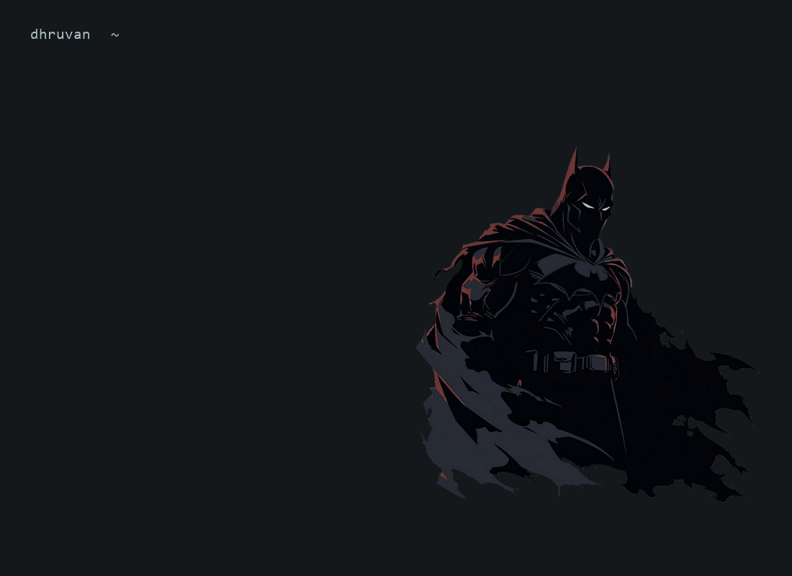

  <picture>
    <source media="(prefers-reduced-motion: reduce)" srcset="./terminal-v5-preview.png">
    
  </picture>

  <code>python</code> &nbsp; <code>pandas</code> &nbsp; <code>sqlite</code> &nbsp; <code>n8n</code> &nbsp; <code>rest apis</code>

 

  <a href="https://github.com/hidhruvan-prog/automation-demos">automation demos</a> &nbsp; / &nbsp;
  <a href="https://github.com/hidhruvan-prog/sankalp-block-planner">sankalp</a> &nbsp; / &nbsp;
  <a href="https://github.com/hidhruvan-prog/Machine-Learning-Fundamental">machine learning</a> &nbsp; / &nbsp;
  <a href="https://github.com/hidhruvan-prog/DataVisualisation">data visualisation</a>

<a href="mailto:hidhruvan@gmail.com">contact</a>

<!-- Batman illustration source: https://www.pinterest.com/pin/dc-batman-black-minimalist-sticker-in-2025--185773553374370638/ -->
