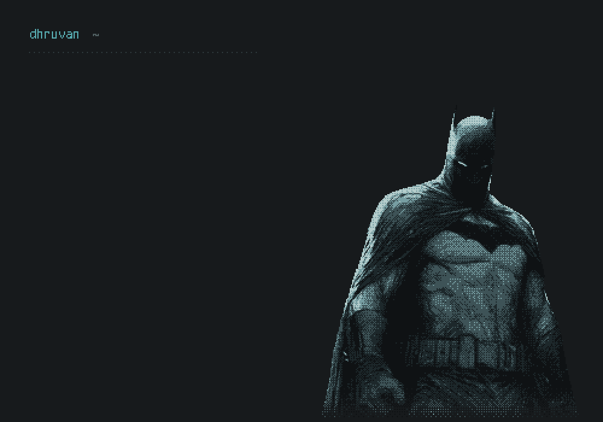

<picture>
  <source media="(prefers-reduced-motion: reduce)" srcset="./terminal-bitmap-preview.png">
  
</picture>

 

<samp>python / pandas / numpy / scikit-learn</samp>

 

<samp><b>./work</b></samp>

<samp>
<a href="https://github.com/hidhruvan-prog/automation-demos">automation-demos/</a> 
document extraction, grounded Q&amp;A, and lead routing.
</samp>

<samp>
<a href="https://github.com/hidhruvan-prog/sankalp-block-planner">sankalp-block-planner/</a> &nbsp; <a href="https://hidhruvan-prog.github.io/sankalp-block-planner/">[demo]</a> 
railway block-planning prototype using simulated data.
</samp>

<samp>
<a href="https://github.com/hidhruvan-prog/Machine-Learning-Fundamental">machine-learning-fundamental/</a> 
notebooks on classification, regression, and clustering.
</samp>

<samp>
<a href="https://github.com/hidhruvan-prog/DataVisualisation">data-visualisation/</a> 
data analysis and visualisation coursework.
</samp>

 

<samp><a href="mailto:hidhruvan@gmail.com">mail</a> / <a href="https://github.com/hidhruvan-prog?tab=repositories">all repositories</a></samp>

