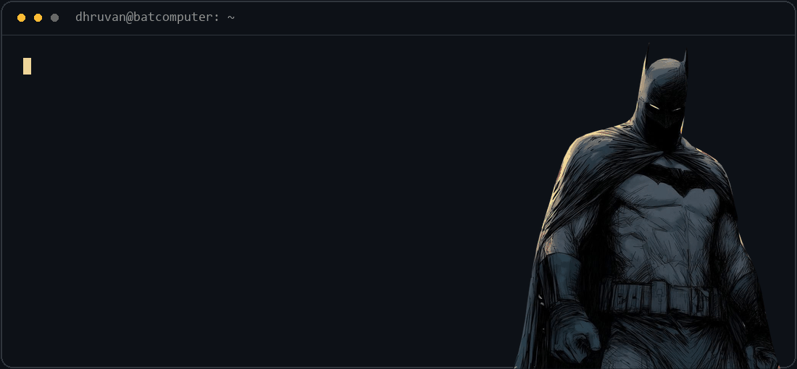

  

### Building, experimenting, learning.

Second-year **BCA (AI & ML)** student at **Alliance University, India**. I enjoy turning ideas into working prototypes, exploring machine learning, and using AI to help build useful things.

### In my toolkit

`Python` · `pandas` · `SQLite` · `n8n` · `REST APIs` · `Claude API` · `Jupyter`

### A few things I've been working on

| Project | What's inside |
| :--- | :--- |
| [Automation demos](https://github.com/hidhruvan-prog/automation-demos) | Document-to-CRM extraction, a grounded assistant, and an explainable lead router. |
| [Machine learning fundamentals](https://github.com/hidhruvan-prog/Machine-Learning-Fundamental) | Projects exploring machine learning fundamentals in notebooks. |
| [SANKALP](https://github.com/hidhruvan-prog/sankalp-block-planner) | A prototype console for AI-powered automatic block planning. |
| [Data visualisation](https://github.com/hidhruvan-prog/DataVisualisation) | Data visualisation work in Jupyter notebooks. |

### Open to collaboration

Available for automation and API integration projects. [Get in touch](mailto:hidhruvan@gmail.com).

---

Learn something. Build something. Repeat.

