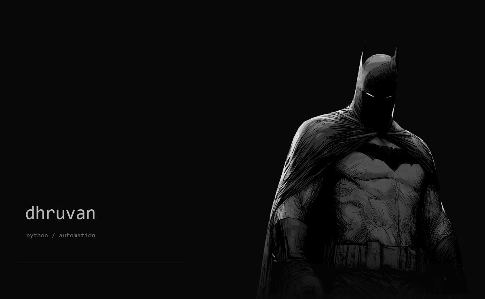

  

 

BCA · AI & ML · Alliance University

**Selected work**

[Automation demos](https://github.com/hidhruvan-prog/automation-demos) - document extraction, a grounded assistant, and lead routing.  
[SANKALP](https://github.com/hidhruvan-prog/sankalp-block-planner) - automatic block-planning prototype.  
[Machine learning](https://github.com/hidhruvan-prog/Machine-Learning-Fundamental) - fundamentals, explored in notebooks.  
[Data visualisation](https://github.com/hidhruvan-prog/DataVisualisation) - data, made visible.

 

`Python` &nbsp; `pandas` &nbsp; `SQLite` &nbsp; `n8n` &nbsp; `REST APIs`

 

[Contact](mailto:hidhruvan@gmail.com) &nbsp; / &nbsp; [Repositories](https://github.com/hidhruvan-prog?tab=repositories)